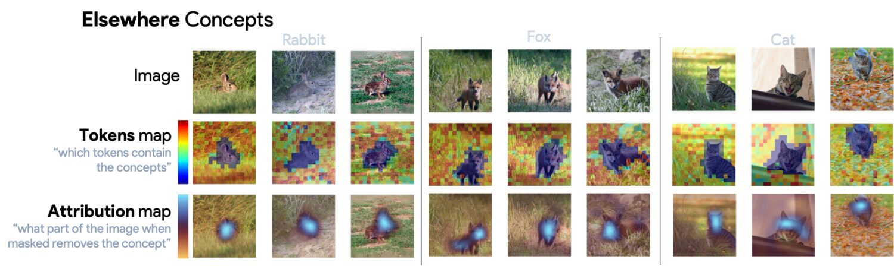

# Writing guide — study guide for "Into the Rabbit Hull"

The contract for every page of this guide. The format is the one of `Optimal_transport_ML/v2` (same build
system, same components); a good page of that guide, e.g. `Optimal_transport_ML/v2/_source/pages/Lesson03/`,
shows the expected tone and density.

Paper: T. Fel, B. Wang et al., *Into the Rabbit Hull: From Task-Relevant Concepts in DINO to Minkowski
Geometry*, arXiv:2510.08638v3, ICLR 2026, CC BY 4.0.

## 1. The reader and the goal

A master's student (MVA) with a solid background in linear algebra, optimization and probability, who knows
what a neural network is but has never worked on interpretability, vision transformers or convex geometry.
After reading the guide, the student must be able to **explain every section, figure, formula and proof of the
paper alone**, and to answer questions about it in an oral presentation.

## 2. Writing rules

1. **English**, second person, short sentences. Define a term at its first use (`<em class="new">term</em>`).
2. **Why before how.** Every notion starts with the problem it solves.
3. **Faithful to the paper.** Every important statement of the paper (definition, lemma, claim, number) is
   quoted in a `paper` box with its reference (`§5 · p. 12`, `Fig. 10 · p. 12`, `App. J · p. 47`; pages of the
   arXiv v3 PDF), then **decoded** symbol by symbol (`dl.decode`). Do not invent content of the paper. What the
   guide adds is presented as such: intuition, reminder, worked example, or an `ours` box for a critical remark.
4. **Every figure of the paper is shown and read.** Include the figure (`figure.paperfig`, §5) and follow it
   with a `method` box “How to read this figure”: what each axis, colour and panel is; what to look at; the
   numbers one can read off; what the authors conclude; what the figure does not show.
5. **Reminders where they are used.** When a prerequisite is needed (coherence, softmax, convex hull,
   Minkowski sum, PCA, entropy…), recall it on the spot in a short `recall` box that says exactly what is used,
   with a link to the toolbox page (`02_toolbox.html#anchor`, anchors in §3).
6. **Step-by-step computations** in `ol.steps`, each line with its justification (`span.why`). Never “clearly”.
7. **Idea before proof:** an `idea` box (3–6 lines), then the full proof in `details.fold.proof`. When the
   paper's proof has a gap or a typo, give the corrected argument and say what was changed in a `remark` box.
8. **A worked example with numbers** for every important notion — small, checkable by hand. **Every number on a
   page is computed by a script before it is written** (`checks/check_<page>.py`, numpy only; keep the script).
9. **Pitfalls** (`pitfall`), **reflexes** (`reflex`, “When you see … → …”), **quick checks** (`quiz`) on the way.
10. **Separate the paper from our reading.** Criticism, alternative explanations and things the paper does not
    say go in `ours` boxes (“Our reading — …”), never mixed into the description of the paper. Keep them short
    in pages 1–5 and link to page 6 (`06_critical_reading.html#anchor`), which develops them.
11. **Exercises** at the end of pages 1–5: 6–10 graded exercises (★ to ★★★) with a hint and a full solution.
12. No filler, no hype, no “as we will see”. Say where things are (links), not that they exist.

## 3. Pages, content and fixed anchors

Other pages link to the anchors listed here (h2 ids, and the h3 ids in parentheses): they must exist with
exactly these ids. Add other ids freely.

- `index.html` — start here: how to use the guide, the paper in one page, claims and evidence, map of the
  paper, notation, key numbers.
- `01_background.html` — the model and the method. Anchors: `vit` (`tokens`, `attention`, `block`,
  `registers`), `dinov2` (`dino-loss`, `ibot`, `koleo`, `probes`), `interp` (`attribution-vs-concepts`,
  `superposition`, `lrh`), `dictionary-learning` (`zoo`, `sae`, `topk`, `archetypal-sae`), `seeing-concepts`
  (`heatmaps`, `feature-viz`, `demo`).
- `02_toolbox.html` — the mathematics, recalled from scratch. Anchors: `frames` (`gram-coherence`,
  `welch-grassmannian`, `jl-random`, `tight-frames-spectrum`), `scores` (`stable-rank`, `hoyer`, `entropy`,
  `cosine`), `projections` (`pca`, `umap`), `convex` (`convex-hull`, `simplex-barycentric`, `polytopes-faces`,
  `high-dim-hulls`), `minkowski` (`minkowski-sum`, `zonotopes`, `support-functions`, `decomposability`),
  `softmax` (`softmax-properties`), `aa` (`archetypal-analysis`, `aa-sandwich`), `graphs` (`knn-geodesics`),
  `attribution` (`grad-input`, `rise`).
- `03_concepts_tasks.html` — paper §2–4, App. B, C, D, G. Anchors: `lrh-setup`, `importance`,
  `tasks-overview`, `elsewhere`, `borders`, `depth`, `token-types`, `summary`, `exercises`.
- `04_statistics_geometry.html` — paper §5–6, App. E, F, H, I. Anchors: `occurrence`, `coactivation`,
  `dictionary-geometry`, `antipodal`, `geometry-vs-usage`, `beyond-lrh`, `pca-maps`, `position`,
  `interpolative`, `summary`, `exercises`.
- `05_minkowski.html` — paper §7–8, App. J. Anchors: `why`, `definition`, `theory` (`gardenfors`,
  `precedents`, `single-head`, `affine`, `multi-head`, `concentration`), `evidence` (`ev-chords`, `ev-aa`,
  `ev-blocks`), `implications` (`imp-regions`, `imp-steering`, `imp-identifiability`), `limits`, `summary`,
  `exercises`.
- `06_critical_reading.html` — what is solid, what is not, and our own checks (toy examples and DINOv2
  experiments behind the report). Anchors: `verdict`, `nested`, `architecture`, `layernorm`, `diagnostics`
  (`diag-chords`, `diag-aa`, `diag-blocks`), `identifiability`, `position-tile`, `lab`, `errata`.
- `07_selftest.html` — questions with answers, the talk, glossary. Anchors: `selftest`, `talk`, `glossary`.

Structure of a content page (parts in `pages/<page>/NN_name.html`, concatenated in file-name order):

```
00_intro.html     header comment, objectives box, “Before you start” (h2 id="start"): how to read the page,
                  the story of the page in 5–7 steps (ol.chain), what you need (links), notation decoder (table)
01_….html …       one file per section (h2); each: tldr → problem → paper box + decoding → figure + how to read it
                  → worked example → idea → proof (fold) → reminders / pitfalls / reflexes / quick checks / ours
xx_wrapup.html    summary (box summary), reflexes (ul.checklist), what the next page does with it
xx_exercises.html exercises with hints and solutions
```
Header comment of the first part:
```
<!--
title: Part III — The Minkowski Representation Hypothesis
short: 5 · Minkowski
description: one sentence (meta description)
subtitle: what the page covers, one or two sentences
kicker: Into the Rabbit Hull · study guide · paper §7
-->
```
**Every h2 and h3 has an explicit, stable id** (lower case, hyphens; the build fails otherwise), unique in the
page. Number the h2 (“1. …”, “2. …”).

## 4. Components

Formulas: `$...$` inline, `$$...$$` display (rendered by KaTeX at build time); `\$` for a dollar sign. An
inline formula must not contain an empty line. A display formula is never inside a `<p>`. Split long display
formulas with `aligned` so that they fit the column (the checker reports them). `<` and `>` are allowed inside
formulas. No formula inside an HTML attribute.

Macros (see `build.mjs`): `\R \E \N \X \Y \Pc \Qc \Tc \Ac \Sc \Cc`; bold vectors `\va \vb \vd \ve \vp \vq \vu
\vv \vw \vx \vy \vz \vk \vg \vt \vm \val \vbe \vga \vom \vphi \vsig`; bold matrices `\mA \mB \mC \mD \mG \mK
\mP \mQ \mS \mV \mW \mX \mY \mZ \mI \mU \mL \mH \mR`; `\conv \relint \supp \diam \tr \rank \Ima \spn \softmax
\diag \cov \Var \LN \argmin \argmax \msum` ($\oplus$) `\bigmsum \simplex` ($\Delta$) `\eps \T` (transpose:
`\mD\T`) `\ind \dd \norm{x} \abs{x} \ps{a}{b}`.

```html
<p class="tldr">One sentence that summarises the section.</p>
<div class="box paper"><div class="box-h">In the paper <span class="ref">§7 · p. 18</span></div> … faithful quote … </div>
<dl class="decode"><dt>$symbol$</dt><dd>meaning in words</dd> … </dl>
<div class="box recall"><div class="box-h">Reminder — convex hull</div> … <a href="02_toolbox.html#convex-hull">more</a></div>
<div class="box ours"><div class="box-h">Our reading — the values depend on the image</div> … </div>
<div class="box lab"><div class="box-h">Checked on DINOv2</div> … <a href="06_critical_reading.html#lab">details</a></div>
<div class="box def|thm|intu|example|idea|reflex|pitfall|method|remark|summary|objectives"><div class="box-h">Title</div> … </div>
<ol class="steps"><li>$$ … $$<span class="why">why this line is true</span></li></ol>
<details class="fold proof|hint|sol|more"><summary>Full proof</summary><div class="fold-body"> … </div></details>
<div class="exo"><div class="exo-h">Exercise N — Title <span class="lvl">★★</span></div> … </div>
<div class="quiz"><p>Question?</p><details class="fold sol"><summary>Answer</summary><div class="fold-body">…</div></details></div>
<div class="cols"> … </div>   <div class="table-wrap"><table> … </table></div>   <ol class="chain"> … </ol>
<div class="nums"><div class="num"><b>32,000</b><span>atoms in the dictionary</span></div> … </div>
<span class="tag solid|suggestive|speculative|own">solid</span>
```
Links: other pages as `0N_name.html#anchor` with anchors of §3 only (or anchors of your own page); the report
and slides as `../report/report.pdf`, `../slides/slides.pdf` (only once they exist); the paper as
`https://arxiv.org/abs/2510.08638`.

## 5. Figures

**Figures of the paper** (CC BY 4.0) are in `paper_figures/` (list in the project notes, with the figure
numbers). Include them with their number, a caption in your own words and the source line:
```html
<figure class="paperfig">
<figcaption><strong>Fig. 4 of the paper.</strong> … what it shows …
<span class="src">From the paper (Fel, Wang et al., 2026), CC BY 4.0.</span></figcaption></figure>
```
(`data-src`, not `src`: the build inlines the image. `class="paperfig narrow"` for small single plots.)

**Static figures of the guide**: written by `figures_<NN>.py` (e.g. `figures_05.py`), which imports
`figures_common` (classes `Fig`, `Canvas`) and writes `figures/<NN>/*.svg`
(`Canvas(name, W, H, label, sub="05")`); included with
`<figure class="fig"><!-- include figures/05/name.svg --><figcaption>…</figcaption></figure>`.
Compute every coordinate in the script. Colours are CSS classes only (strokes `ln c1…c6`, fills `f1…f6`,
washes `a1…a5`, `am`; text `tx tx-s tx-b tx-i`; `ax`, `gr`, `dash`, `thin`), so that figures follow the light
and dark themes. Colour code of the guide: **1 (blue) = archetypes, polytopes, the convex / Minkowski picture;
2 (orange-red) = directions, the linear / sparse picture; 3 (green) = data points, tokens; 5 (purple) = a second
tile or a second model; grey = baselines and null models.** Use Unicode in SVG text (α, ⊕, √…), never `_` or
`^`. At most three colours carry meaning in one figure; add a legend or direct labels in text colour.

**Interactive figures**: `widgets/<page>.js` (e.g. `widgets/05_minkowski.js`), a code fragment inserted by the
build inside the scope of `app.js`, which registers `WIDGETS.name = function (box) { … }` (`name` unique in the
whole guide: prefix it with the page number, e.g. `p5sum`). Helpers of `app.js` (never redefine these names;
prefix your own): `el`, `fmt`, `Plot` (axes, poly, fn, dot, seg, text, area, clip, unclip, tx, ty, ix, iy),
`svgPoint`, `scaffold`, `slider`, `select`, `button`, `checkbox`, `readout`, `legend`, `addSvg`, `frac`,
`matStr`, `mulberry32`, `gaussRand`, `convexHull(pts)`, `minkowskiSum(A, B)`, `polyArea`, `pointInConvex`,
`supportFn(P, u)`, `softmaxT(x, tau)`, `combo(V, w)`, `draggable(plot, pts, onMove, opts)`, `mmul`, `msym`,
`msqrt`, `minv`, `ellipsePts`, `WeightTriangle`, `redrawers`. Place with
`<div class="widget" data-widget="name"><p class="w-noscript">Interactive figure (needs JavaScript).</p></div>`,
followed by a paragraph “What to look at: …”. Pitfalls: `new Plot(svg, …)` and `Plot.clear()` empty the whole
`svg`; `svg .ln` sets `stroke-width` in CSS (variable widths need an inline `style`); `fmt` prints “—” for NaN.
A widget must redraw from scratch in one function and push it to `redrawers` (theme switch).

## 6. Build and check

```
cd ML_A/Project_Rabbit_Hull/guide/_source
python3 figures_05.py                      # static figures of the page
node build.mjs 05_minkowski.html           # renders only this page; fails on any KaTeX error, heading
                                           # without id, broken anchor, missing image, JS syntax error
node tools/check_page.cjs 05_minkowski.html --shots /tmp/…/shots_05
                                           # console errors, widgets drawn, overflowing formulas, phone width;
                                           # screenshots of every figure and widget
```
Look at the screenshots (light and dark) and fix overlapping labels, clipped text, empty plots.

## 7. Files, and working in parallel

Several pages are written at the same time. A writer creates or edits **only its own files**:
`pages/<page>/`, `widgets/<page>.js`, `figures_<NN>.py`, `figures/<NN>/`, `checks/check_<NN>.py`. Shared files
(`app.js`, `style.css`, `build.mjs`, `template.html`, `figures_common.py`, `GUIDE.md`, other pages) are not
edited by writers; ask for a change in the final report instead. No git operations.

## 8. Notation (the paper's, kept in the guide)

Row-vector convention: an activation is a row $\va\in\R^d$, the dictionary is $\mD\in\R^{c\times d}$ with atoms
as rows $\mD_i$, codes are rows $\vz\in\R^c$, and $\va=\vz\mD$; for all tokens, $\mA\approx\mZ\mD$.
$d=768$ (width), $t=261$ tokens per image (1 cls + 4 registers + 256 patches), $c=32{,}000$ atoms, $k=8$ active
codes per token, $n$ images. Probe $\mW\in\R^{o\times d}$, $\mY=\mA\mW\T$, $\mW'=\mD\mW\T$.
MRH: archetypes $\Ac=(\va_1,\dots,\va_c)$, tiles $\Tc_i$, polytopes $\Pc_i=\conv(\Ac_{\Tc_i})$, activation
space $\X$, Minkowski sum $\msum$, simplex $\simplex^k$, active set $S$. Attention: queries $\mQ$, keys $\mK$,
values $\mV$, weights $\val\in\simplex^m$, heads $h=1..H$, output projections $\mW_O^{(h)}$.
The paper reuses letters ($\mA$ = activations, attention matrix, AA coefficients; $\mZ$ = codes, archetypes;
$\X$ = images, activation space): say which one is meant whenever it could be confused.
